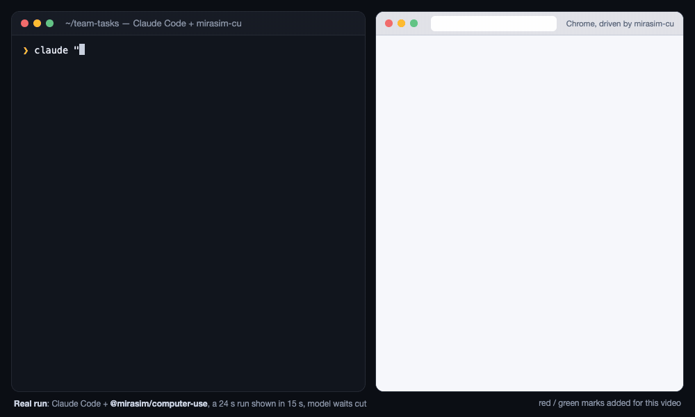
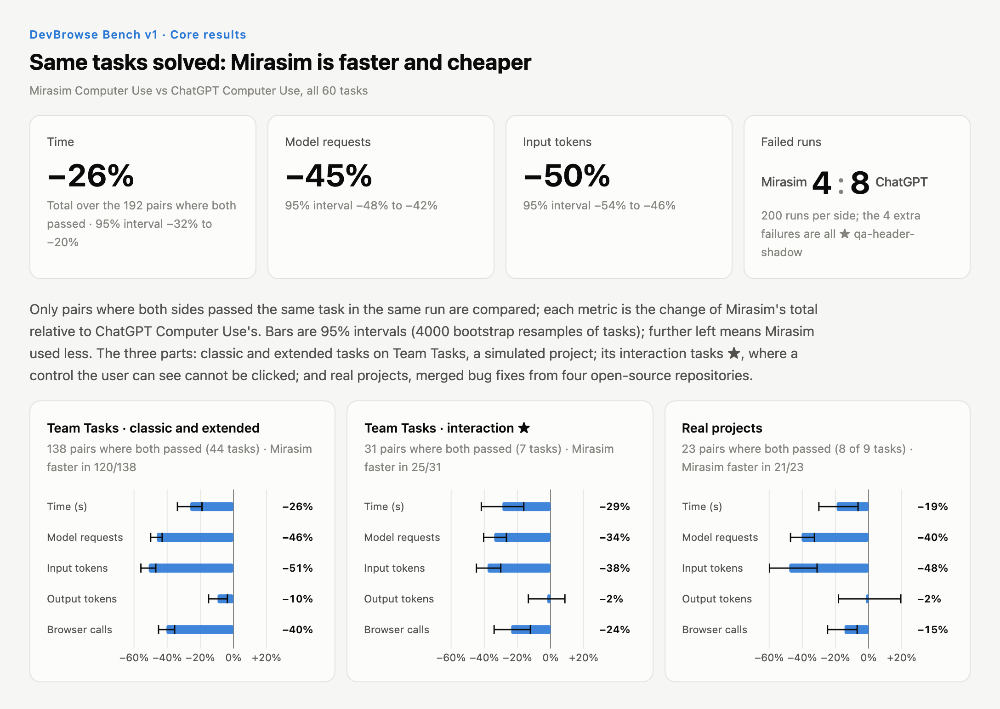

# Mirasim Computer Use

[English](README.md) | [简体中文](README.zh-CN.md) | 日本語 | [한국어](README.ko.md)

[](https://www.npmjs.com/package/@mirasim/computer-use)
[](LICENSE)
[](https://huggingface.co/datasets/mirasim-ai/devbrowse-bench)

Claude Code、Codex、そしてあらゆる MCP エージェントのための computer use です。ブラウザ、macOS アプリ、Electron アプリをアクセシビリティツリーを通じて操作する、オープンソースの MCP サーバーです。独自のモデルは動かさず、API キーも必要ありません。[Mirasim](https://mirasim.ai) デスクトップアプリには同じツールが組み込まれています（Settings → Computer Use）。



<sub>実際の実行の記録です。実際は 24 秒かかったところを、モデルの待ち時間を省いて 15 秒にしています。Claude Code がブラウザで自分の変更を確認し、新しいヘッダーのレイヤーに覆われたコントロールを見つけ、CSS を修正して 1 回の呼び出しで再確認します。赤と緑のマークは動画用に追加したものです。[MP4](docs/media/demo.mp4)</sub>

- **1 回の呼び出しで一連の手順をまとめて実行し、各手順が結果を報告します。** エージェントは短いスクリプト（開く、入力する、選ぶ、クリックする、待つ、読む）を書きます。結果には各手順が何をしたかが示され、最後に 1 回分の観測結果が付くので、モデルがクリックのたびに画面を見ることはありません。画面はテキスト、つまりアクセシビリティツリーから取った要素の番号付きリストとして返ります。ピクセルを使うのはテキストでは足りないときだけです。
- **クリックは、ユーザーのマウスが当たる場所に当たります。** 別のレイヤーの下にあるコントロールへのクリックは失敗し、邪魔をしているレイヤーを名指しします（«fixed bar at the top of the viewport»）。ユーザーにはクリックできないコントロールにクリックが届いてしまうことはありません。
- **自分のブラウザ、自分のデスクトップ。** サインインしている Chrome は Mirasim 拡張機能を通じて、ネイティブの macOS アプリはマウスとキーボードを奪わずにバックグラウンドで、Electron アプリはデバッグポート経由で操作します。

[DevBrowse Bench v1](#ベンチマーク) では、ChatGPT Computer Use と比べて所要時間が 26% 短く、モデルへのリクエストが 45% 少なく、入力トークンは半分でした。

## インストール

Node.js 22.19 以降が必要です。

```sh
claude mcp add mirasim-cu -- npx -y @mirasim/computer-use mcp   # Claude Code
codex mcp add mirasim-cu -- npx -y @mirasim/computer-use mcp    # Codex
```

あとは、mirasim-cu のブラウザで何かを確認するようエージェントに頼んでください。Codex は、`~/.codex/config.toml` で 2 つのツールを承認するまで、MCP の呼び出しのたびに確認を求めます。その設定、サインイン済みの Chrome、macOS アプリと Electron アプリ、エージェントスキル、コマンドラインについては [docs/setup.md](docs/setup.md)（英語）を参照してください。

## 他のツールとの比較

各プロジェクトがドキュメントに記載している内容です（2026-11-18 に確認。出典は表の下にあります）。

| | Mirasim Computer Use | [Playwright MCP](https://github.com/microsoft/playwright-mcp) | [browser-use](https://github.com/browser-use/browser-use) | [Anthropic computer use](https://platform.claude.com/docs/en/agents-and-tools/tool-use/computer-use-tool) | [ChatGPT Computer Use](https://learn.chatgpt.com/docs/computer-use) |
|---|---|---|---|---|---|
| オープンソース | Apache-2.0 | Apache-2.0 | MIT。Browser Use Cloud は有料サービス | いいえ：API のツール（リファレンスデモは MIT） | いいえ：ChatGPT デスクトップアプリの一部 |
| Claude Code・Codex 向けの MCP サーバー | はい | はい | はい（`browser-use --cli-mcp`） | いいえ：API のツール。Claude Code には組み込み済み | いいえ：ChatGPT デスクトップアプリの中にある |
| 独自のモデル | なし。お使いのエージェントが操作する | なし | 同梱のエージェントにはある。MCP モードにはない | Claude | OpenAI のモデル |
| モデルが読むもの | テキスト化したアクセシビリティツリー。スクリーンショットは求めに応じて | テキスト化したアクセシビリティスナップショット。ビジョンはオプトイン | 実行した Python の出力とスクリーンショット | スクリーンショットとピクセル座標 | スクリーンショット。それ以外は記載なし |
| 1 回の呼び出しで複数の手順 | はい：スクリプトで実行し、各手順を報告 | 1 アクションにつき 1 ツール。`browser_run_code_unsafe` で Playwright スクリプトを実行 | はい：`browser_exec` で Python を実行 | 1 ターンに複数のアクション（バッチ）。ツール呼び出しはアクションごとに 1 回 | 記載なし |
| 覆われたコントロールへのクリック | 失敗し、覆っているレイヤーを名指しする | 要素がクリックを受け取れるまで待ち、受け取れなければタイムアウトする | 記載なし | 記載なし | 記載なし |
| サインイン済みのブラウザ | Mirasim 拡張機能 | Playwright 拡張機能（Chrome、Edge）または CDP エンドポイント | リモートデバッグ経由で起動中の Chrome | Claude in Chrome 拡張機能 | ChatGPT 拡張機能 |
| ネイティブのデスクトップアプリ | macOS（バックグラウンドで） | いいえ | いいえ（macOS 向けの別の実験的プロジェクトがある） | VM またはコンテナ内の任意のアプリ。Claude Code では macOS（プレビュー） | macOS（バックグラウンドで）と Windows |
| Electron アプリ | はい（デバッグポート経由） | MCP サーバーでは非対応 | 記載なし | Claude Code の画面操作を通じて | 記載なし |
| DevBrowse Bench v1 | 時間 −26%、モデルへのリクエスト −45% | 未実施 | 未実施 | 未実施 | 比較の基準 |

<details>
<summary>出典</summary>

- Playwright MCP：[README](https://github.com/microsoft/playwright-mcp)（v0.0.85）。覆われた要素については Playwright の [actionability チェック](https://playwright.dev/docs/actionability)（"Receives Events"）。
- browser-use：[README](https://github.com/browser-use/browser-use)（v1.0.6）、[MCP サーバー](https://docs.browser-use.com/open-source/mcp)、[ブラウザ](https://docs.browser-use.com/open-source/browsers)、[macos-harness](https://github.com/browser-use/macos-harness)。
- Anthropic：[computer use ツール](https://platform.claude.com/docs/en/agents-and-tools/tool-use/computer-use-tool)、[リファレンスデモ](https://github.com/anthropics/claude-quickstarts/tree/main/computer-use-demo)、Claude Code の [computer use](https://code.claude.com/docs/en/computer-use) と [Chrome](https://code.claude.com/docs/en/chrome)。
- OpenAI：ChatGPT の [computer use](https://learn.chatgpt.com/docs/computer-use)、[ブラウザ](https://learn.chatgpt.com/docs/browser)、[Chrome 拡張機能](https://learn.chatgpt.com/docs/chrome-extension)。API の [computer use ツール](https://developers.openai.com/api/docs/guides/tools-computer-use) は 1 回の呼び出しで `actions` 配列を受け取りますが、表ではこれをアプリの挙動として数えていません。
- DevBrowse Bench v1 で比較したのは Mirasim Computer Use と ChatGPT Computer Use だけです。ハーネスが ChatGPT デスクトップアプリ内の Codex を動かす仕組みのため、ほかのツールには比較できる実行がありません。

</details>

## ベンチマーク



[DevBrowse Bench](https://huggingface.co/datasets/mirasim-ai/devbrowse-bench) は、開発作業におけるブラウザ利用を測ります。コーディングエージェントが Web アプリを変更し、その後、自分の作業をブラウザで確認するというものです。v1 には 60 タスクがあり、図の 3 つのパネルに対応する 3 つのパートに分かれています。51 タスクは、このベンチマークのために書かれた React + Vite 製の模擬タスク管理アプリ Team Tasks 上のもので、基本タスクと拡張タスクが 44 件（機能追加、バグ修正、QA チェック）、インタラクションタスク ★ が 7 件（ユーザーに見えているコントロールがクリックできないバグ）です。残りの 9 タスクは実際のプロジェクト上のもので、Excalidraw、Lexical、tldraw、react-admin のオープンソースリポジトリでマージされたバグ修正です。

各タスクはペアで実行します。両側を同時に、ChatGPT デスクトップアプリ内の Codex で、同じモデル（`gpt-6.1-sol`、reasoning effort は medium）、同じプロンプト、同じ初期コードで動かします。違いは、エージェントに使うよう指示するブラウザツールだけです。ChatGPT Computer Use（Codex のアプリ内ブラウザ）か、MCP サーバーとしての Mirasim Computer Use 0.1.0-rc.5 のどちらかです。実行は各側 200 回で、2026-11-06 と 2026-11-07 に行いました。時間、モデルへのリクエスト、トークンは Codex 自身のセッション記録から取り、すべての実行をルールベースの判定器で採点しました。

| | ChatGPT Computer Use | Mirasim Computer Use |
|---|---|---|
| 合格した実行 | 192 / 200 | 196 / 200 |

両側とも合格した 192 ペアでの結果です（変化 = Mirasim の合計 / ChatGPT の合計 − 1、95% 区間はタスクのリサンプリングによるもの）。

| 指標 | 変化 | 95% 区間 |
|---|---|---|
| 時間 | −26% | −32% 〜 −20% |
| モデルへのリクエスト | −45% | −48% 〜 −42% |
| 入力トークン | −50% | −54% 〜 −46% |
| 出力トークン | −8% | −13% 〜 −3% |
| ブラウザ呼び出し | −37% | −41% 〜 −32% |

短縮された時間の大半は往復の分です。エージェントのモデルへのリクエストは 45% 減った一方、エージェントが書いた出力トークンは 8% しか減っていません。`observe()` は要素をデータとして返すので、エージェントは確認処理をスクリプトの中に入れ、クリックのたびにページを読む代わりに判定結果を受け取ります。また、クリックはユーザーのマウスが当たる場所に当たります。覆われたコントロールへのクリックは失敗し、クリックを受け取ったレイヤーを名指しします。もう一方の側で 4 件多かった失敗は、すべて 1 つのインタラクションタスク ★ でのものです。これは、sticky ヘッダーの下にある透明なレイヤーがツールバーを覆ってマウスクリックを遮っている状況での QA チェックで、ChatGPT Computer Use を使って書かれたレポートは 5 回中 4 回これを見逃し、Mirasim Computer Use を使って書かれたレポートは一度も見逃しませんでした。

これらの数値は、その 2 日間の時点での 2 つのツールを表したものです。実行期間の終わりごろ、ChatGPT Computer Use はブラウザの使い方を変え、1 回の実行に必要なモデルへのリクエストが少なくなり始めました。60 タスクのうち 39 タスクを、2026-11-10 と 2026-11-11 に、より新しいリリースの Mirasim Computer Use を使って同じ方法で再実行したところ、それらのタスクでの時間短縮は約 −16% でした（ここでの同じタスクでは −25%）。この再実行は v1 には含まれません。

タスク、判定器、すべての実行、完全なレポートは Hugging Face の [devbrowse-bench データセット](https://huggingface.co/datasets/mirasim-ai/devbrowse-bench)（[v1 レポート](https://huggingface.co/datasets/mirasim-ai/devbrowse-bench/blob/main/results/v1/REPORT.md)）にあります。

## ツール

ツールは 2 つで、セッション開始時にドライバーごとに組み立てられます。

| ツール | 役割 |
|---|---|
| `computer_repl` | 永続的な（PERSISTENT）セッションで GUI を操作する JavaScript。読み取り（`observe()`、`find(name)`、`text()`、`page()`、`screenshot()`、`diagnostics()`）、アクション（`click`、`hover`、`setText`、`keys`、`scroll`、`wait`、`focus` + ドライバー固有の動詞 — `openUrl`、`newTab`、`selectOption`、`paste`、`launchApp`、`menu`、…）、そして動詞を 1 つのタブ / ウィンドウ / アプリに結びつけるサーフェスのハンドル（HANDLES：`computer.surfaces()` / `computer.surface(id)`）。トップレベルの宣言は呼び出しをまたいで保持される。最初の結果に API リファレンスが含まれる。どの実行も 1 回分の観測結果と changed/frozen の判定で終わる |
| `computer_repl_reset` | JavaScript のバインディングを破棄する。サーフェスはそのまま |

要素の観測結果はデフォルトで差分方式です。前回から変化が少ないときは差分だけを送り（ref は維持されるので、変わっていない行は省かれます）、定期的に完全なリストを送り直します。

## ライセンス

[Apache License 2.0](LICENSE) © MIRASIM, INC. ブラウザ拡張機能のブリッジの一部は [Playwright](https://github.com/microsoft/playwright)（Apache-2.0、© Microsoft Corporation）をもとに改変したものです。[NOTICE](NOTICE) を参照してください。Windows ヘルパーに静的リンクされている Rust クレートとそのライセンスは [THIRD_PARTY_NOTICES](THIRD_PARTY_NOTICES) に記載しています。

「Mirasim」および Mirasim のロゴは MIRASIM, INC. の商標であり、Apache License のもとでライセンスされるものではありません。Chrome、Claude、Codex、ChatGPT、macOS、Windows はそれぞれの所有者の商標です。本プロジェクトはこれらの所有者と提携しておらず、その承認も受けていません。
