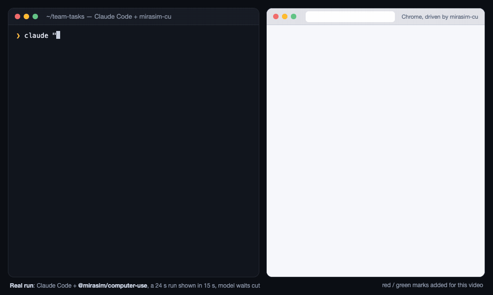
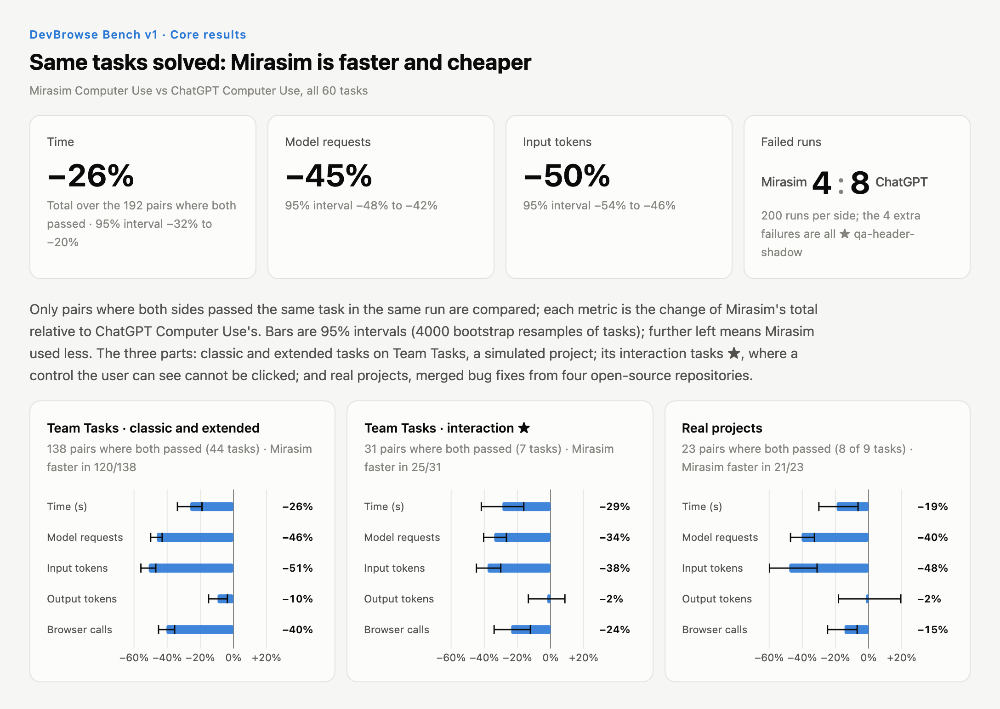

# Mirasim Computer Use

[English](README.md) | [简体中文](README.zh-CN.md) | [日本語](README.ja.md) | 한국어

[](https://www.npmjs.com/package/@mirasim/computer-use)
[](LICENSE)
[](https://huggingface.co/datasets/mirasim-ai/devbrowse-bench)

Claude Code, Codex를 비롯한 모든 MCP 에이전트를 위한 컴퓨터 사용(computer use) 도구입니다.
접근성 트리(accessibility tree)를 통해 브라우저, macOS 앱, Electron 앱을 조작하는 오픈 소스 MCP
서버로, 자체 모델을 실행하지 않으며 API 키도 필요하지 않습니다. [Mirasim](https://mirasim.ai)
데스크톱 앱에는 같은 도구가 내장되어 있습니다(설정(Settings) → Computer Use).



<sub>실제 실행 화면입니다. 실제로는 24초가 걸렸고, 모델 대기 시간을 덜어 내 15초로 줄였습니다. Claude Code가 브라우저에서
자신의 변경 사항을 확인하고, 새 헤더 레이어에 가려진 컨트롤을 찾아낸 뒤, CSS를 고치고 한 번의
호출로 다시 확인합니다. 빨간색과 초록색 표시는 영상용으로 덧붙인 것입니다. [MP4](docs/media/demo.mp4)</sub>

- **한 번의 호출로 여러 단계를 이어서 실행하고, 단계마다 결과를 보고합니다.** 에이전트가 짧은
  스크립트(열기, 입력, 선택, 클릭, 대기, 읽기)를 작성하면, 결과에 각 단계가 무엇을 했는지가 담기고
  마지막에 관찰(observation) 하나가 붙습니다. 따라서 모델이 클릭할 때마다 화면을 보지 않습니다.
  화면은 텍스트, 즉 접근성 트리의 요소에 번호를 매긴 목록으로 돌아오며, 픽셀은 텍스트로 부족할
  때만 씁니다.
- **클릭은 사용자의 마우스가 닿을 곳에 닿습니다.** 다른 레이어 아래에 있는 컨트롤을 클릭하면,
  사용자라면 클릭할 수 없었을 컨트롤에 그대로 닿는 대신 실패하고 가로막는 레이어의 이름을 알려
  줍니다(«fixed bar at the top of the viewport», 뷰포트 상단에 고정된 바).
- **사용자 자신의 브라우저와 데스크톱을 조작합니다.** Mirasim 확장 프로그램을 통해 사용자가
  로그인해 둔 Chrome을, 네이티브 macOS 앱은 마우스와 키보드를 빼앗지 않고 백그라운드에서,
  Electron 앱은 디버깅 포트를 통해 조작합니다.

[DevBrowse Bench v1](#벤치마크)에서 ChatGPT Computer Use보다 시간은 26%, 모델 요청 수는 45%
적게 들었고, 입력 토큰은 절반이었습니다.

## 설치

Node.js 22.19 이상이 필요합니다.

```sh
claude mcp add mirasim-cu -- npx -y @mirasim/computer-use mcp   # Claude Code
codex mcp add mirasim-cu -- npx -y @mirasim/computer-use mcp    # Codex
```

그런 다음 에이전트에게 mirasim-cu 브라우저에서 무언가를 확인해 달라고 요청하면 됩니다. Codex는
`~/.codex/config.toml`에서 두 도구를 승인하기 전까지 MCP 호출마다 확인을 요청합니다. 이 설정과
로그인된 Chrome, macOS 앱과 Electron 앱, 에이전트 스킬, 명령줄에 관한 내용은
[docs/setup.md](docs/setup.md)(영어)에 있습니다.

## 다른 도구와 비교

각 프로젝트가 문서에 밝힌 내용을 2026-11-18에 확인한 것입니다(출처는 표 아래에 있습니다).

| | Mirasim Computer Use | [Playwright MCP](https://github.com/microsoft/playwright-mcp) | [browser-use](https://github.com/browser-use/browser-use) | [Anthropic computer use](https://platform.claude.com/docs/en/agents-and-tools/tool-use/computer-use-tool) | [ChatGPT Computer Use](https://learn.chatgpt.com/docs/computer-use) |
|---|---|---|---|---|---|
| 오픈 소스 | Apache-2.0 | Apache-2.0 | MIT; Browser Use Cloud는 유료 서비스 | 아니요: API 도구(참조 데모는 MIT) | 아니요: ChatGPT 데스크톱 앱의 일부 |
| Claude Code·Codex용 MCP 서버 | 예 | 예 | 예(`browser-use --cli-mcp`) | 아니요: API 도구; Claude Code에 내장 | 아니요: ChatGPT 데스크톱 앱 내부 기능 |
| 자체 모델 | 없음; 사용자의 에이전트가 조작 | 없음 | 자체 에이전트에는 있음; MCP 모드에는 없음 | Claude | OpenAI 모델 |
| 모델이 읽는 것 | 텍스트로 된 접근성 트리; 요청 시 스크린샷 | 텍스트로 된 접근성 스냅샷; 비전은 옵트인 | Python 코드가 출력한 내용과 스크린샷 | 스크린샷과 픽셀 좌표 | 스크린샷; 그 밖에는 문서화되지 않음 |
| 한 번의 호출로 여러 단계 | 예: 스크립트로, 단계마다 보고 | 동작당 도구 하나; `browser_run_code_unsafe`로 Playwright 스크립트 실행 | 예: `browser_exec`로 Python 실행 | 한 턴에 여러 동작(배치), 동작마다 도구 호출 하나 | 문서화되지 않음 |
| 가려진 컨트롤 클릭 | 실패하고 가리는 레이어의 이름을 알려 줌 | 요소가 클릭을 받을 수 있을 때까지 기다리고, 끝내 받지 못하면 시간 초과 | 문서화되지 않음 | 문서화되지 않음 | 문서화되지 않음 |
| 로그인된 내 브라우저 | Mirasim 확장 프로그램 | Playwright 확장 프로그램(Chrome, Edge) 또는 CDP 엔드포인트 | 원격 디버깅을 통해 실행 중인 Chrome | Claude in Chrome 확장 프로그램 | ChatGPT 확장 프로그램 |
| 네이티브 데스크톱 앱 | macOS, 백그라운드에서 | 아니요 | 아니요(별도의 실험적 macOS 프로젝트) | VM이나 컨테이너 안의 모든 앱; Claude Code에서는 macOS(프리뷰) | macOS(백그라운드)와 Windows |
| Electron 앱 | 예, 디버깅 포트를 통해 | MCP 서버에서는 지원하지 않음 | 문서화되지 않음 | Claude Code에서 화면 제어를 통해 | 문서화되지 않음 |
| DevBrowse Bench v1 | 시간 −26%, 모델 요청 −45% | 실행하지 않음 | 실행하지 않음 | 실행하지 않음 | 기준선 |

<details>
<summary>출처</summary>

- Playwright MCP: [README](https://github.com/microsoft/playwright-mcp) (v0.0.85); 가려진
  요소: Playwright의 [actionability 검사](https://playwright.dev/docs/actionability)
  ("Receives Events" 항목).
- browser-use: [README](https://github.com/browser-use/browser-use) (v1.0.6),
  [MCP 서버](https://docs.browser-use.com/open-source/mcp),
  [브라우저](https://docs.browser-use.com/open-source/browsers),
  [macos-harness](https://github.com/browser-use/macos-harness).
- Anthropic: [computer use 도구](https://platform.claude.com/docs/en/agents-and-tools/tool-use/computer-use-tool),
  [참조 데모](https://github.com/anthropics/claude-quickstarts/tree/main/computer-use-demo),
  Claude Code의 [computer use](https://code.claude.com/docs/en/computer-use)와
  [Chrome](https://code.claude.com/docs/en/chrome).
- OpenAI: ChatGPT [computer use](https://learn.chatgpt.com/docs/computer-use),
  [브라우저](https://learn.chatgpt.com/docs/browser),
  [Chrome 확장 프로그램](https://learn.chatgpt.com/docs/chrome-extension). API의
  [computer use 도구](https://developers.openai.com/api/docs/guides/tools-computer-use)는 호출마다
  `actions` 배열을 받지만, 표에서는 이를 앱의 동작으로 치지 않았습니다.
- DevBrowse Bench v1은 Mirasim Computer Use와 ChatGPT Computer Use만 비교했습니다. 하네스가
  ChatGPT 데스크톱 앱의 Codex를 조작하므로, 다른 도구에는 비교할 만한 실행 결과가 없습니다.

</details>

## 벤치마크



[DevBrowse Bench](https://huggingface.co/datasets/mirasim-ai/devbrowse-bench)는 개발 작업에서의
브라우저 사용을 측정합니다. 코딩 에이전트가 웹 앱을 수정한 뒤, 브라우저에서 자기 작업을 직접
확인하는 방식입니다. v1에는 60개 과제가 세 부분으로 나뉘어 있으며, 그림의 세 패널이 각 부분에
해당합니다. 51개는 이 벤치마크를 위해 작성한 시뮬레이션 React + Vite 작업 관리 앱인 Team Tasks에서
진행합니다. 기본(classic)·확장(extended) 과제 44개(기능 구현, 버그 수정, QA 점검)와, 사용자 눈에
보이는 컨트롤을 클릭할 수 없는 버그를 다루는 상호작용 과제 ★ 7개입니다. 나머지 9개는 실제
프로젝트에서 진행하며, Excalidraw, Lexical, tldraw, react-admin 오픈 소스 저장소에 병합된 버그
수정입니다.

각 과제는 한 쌍으로 실행합니다. 양쪽 모두 ChatGPT 데스크톱 앱의 Codex에서 동시에, 같은
모델(`gpt-6.1-sol`, 추론 강도 medium), 같은 프롬프트, 같은 시작 코드로 실행합니다. 유일한 차이는
에이전트에게 사용하도록 지시한 브라우저 도구입니다. 한쪽은 ChatGPT Computer Use(Codex의 앱 내장
브라우저), 다른 쪽은 MCP 서버로 연결한 Mirasim Computer Use 0.1.0-rc.5입니다. 2026-11-06과
2026-11-07에 쪽마다 200회씩 실행했습니다. 시간, 모델 요청 수, 토큰은 Codex 자체 세션 기록에서
가져왔고, 모든 실행은 규칙 기반 판정기(judge)로 채점했습니다.

| | ChatGPT Computer Use | Mirasim Computer Use |
|---|---|---|
| 통과한 실행 | 192 / 200 | 196 / 200 |

양쪽 모두 통과한 192쌍 기준입니다(변화 = Mirasim 합계 / ChatGPT 합계 − 1, 95% 구간은 과제를
리샘플링해 산출):

| 지표 | 변화 | 95% 구간 |
|---|---|---|
| 시간 | −26% | −32% ~ −20% |
| 모델 요청 | −45% | −48% ~ −42% |
| 입력 토큰 | −50% | −54% ~ −46% |
| 출력 토큰 | −8% | −13% ~ −3% |
| 브라우저 호출 | −37% | −41% ~ −32% |

절약된 시간의 대부분은 왕복(round trip)에서 나왔습니다. 에이전트의 모델 요청은 45% 줄었지만,
에이전트가 작성한 출력 토큰은 8%만 줄었습니다. `observe()`가 요소를 데이터로 돌려주므로,
에이전트는 클릭할 때마다 페이지를 읽는 대신 확인 로직을 스크립트에 넣고 판정 결과를 돌려받습니다.
또한 클릭은 사용자의 마우스가 닿을 곳에 닿습니다. 가려진 컨트롤을 클릭하면 실패하고, 클릭을
가로챈 레이어의 이름을 알려 줍니다. 상대 쪽에서 더 나온 실패 4건은 모두 하나의 상호작용 과제 ★에서
나왔습니다. sticky 헤더 아래의 투명 레이어가 툴바를 덮어 마우스 클릭을 가로막는 문제를 찾는 QA
점검 과제로, ChatGPT Computer Use로 작성한 보고서는 5회 중 4회 이를 놓쳤고, Mirasim Computer
Use로 작성한 보고서는 한 번도 놓치지 않았습니다.

이 수치는 해당 이틀 동안의 두 도구 상태를 나타냅니다. 실행이 끝날 무렵 ChatGPT Computer Use는
브라우저 사용 방식을 바꾸었고, 실행당 필요한 모델 요청 수가 줄기 시작했습니다. 2026-11-10과
2026-11-11에 60개 과제 중 39개를 같은 방식으로, 더 나중 릴리스의 Mirasim Computer Use로 다시
실행했을 때 해당 과제의 시간 절감은 약 −16%였고, 같은 과제에 대한 이 문서의 결과는 −25%입니다.
이 재실행은 v1에 포함되지 않습니다.

과제, 판정기, 모든 실행 기록과 전체 보고서는 Hugging Face의
[devbrowse-bench 데이터셋](https://huggingface.co/datasets/mirasim-ai/devbrowse-bench)에 있습니다
([v1 보고서](https://huggingface.co/datasets/mirasim-ai/devbrowse-bench/blob/main/results/v1/REPORT.md)).

## 도구

도구는 두 가지이며, 세션 시작 시 드라이버별로 구성됩니다:

| 도구 | 역할 |
|---|---|
| `computer_repl` | 지속(PERSISTENT) 세션에서 GUI를 다루는 JavaScript: 읽기(`observe()`, `find(name)`, `text()`, `page()`, `screenshot()`, `diagnostics()`), 동작(`click`, `hover`, `setText`, `keys`, `scroll`, `wait`, `focus` + 드라이버별 동사 — `openUrl`, `newTab`, `selectOption`, `paste`, `launchApp`, `menu`, …), 그리고 동사를 하나의 탭 / 창 / 앱에 묶는 surface 핸들(HANDLES)(`computer.surfaces()` / `computer.surface(id)`). 최상위 선언은 호출 간에 유지되고, 첫 결과에 API 레퍼런스가 담기며, 모든 실행은 관찰 하나와 changed/frozen 판정으로 끝남 |
| `computer_repl_reset` | JavaScript 바인딩을 버림 — surface는 그대로 둠 |

요소 관찰은 기본적으로 증분 방식입니다. 이전 관찰 이후 바뀐 것이 적으면 diff만 보내고(ref가
유지되므로 바뀌지 않은 줄은 빠짐), 전체 목록은 주기적으로 다시 보냅니다.

## 라이선스

[Apache License 2.0](LICENSE) © MIRASIM, INC. 브라우저 확장 프로그램 브리지의 일부는
[Playwright](https://github.com/microsoft/playwright)(Apache-2.0, © Microsoft Corporation)에서
가져와 수정한 것입니다. [NOTICE](NOTICE)를 참고하십시오. Windows 헬퍼에 정적으로 링크된 Rust
크레이트와 그 라이선스는 [THIRD_PARTY_NOTICES](THIRD_PARTY_NOTICES)에 나와 있습니다.

"Mirasim" 및 Mirasim 로고는 MIRASIM, INC.의 상표이며 Apache License에 따라 라이선스되지
않습니다. Chrome, Claude, Codex, ChatGPT, macOS, Windows는 각 소유자의 상표입니다. 이 프로젝트는
이들과 제휴 관계가 없으며, 이들의 보증을 받지 않았습니다.
