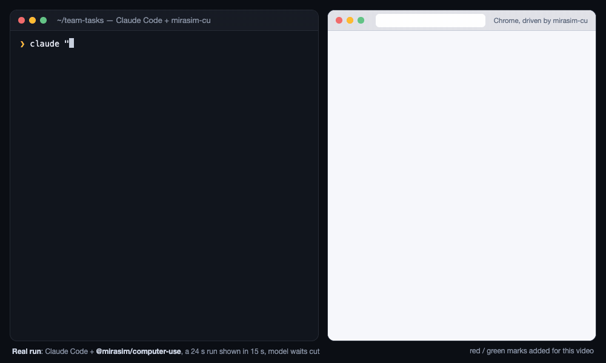
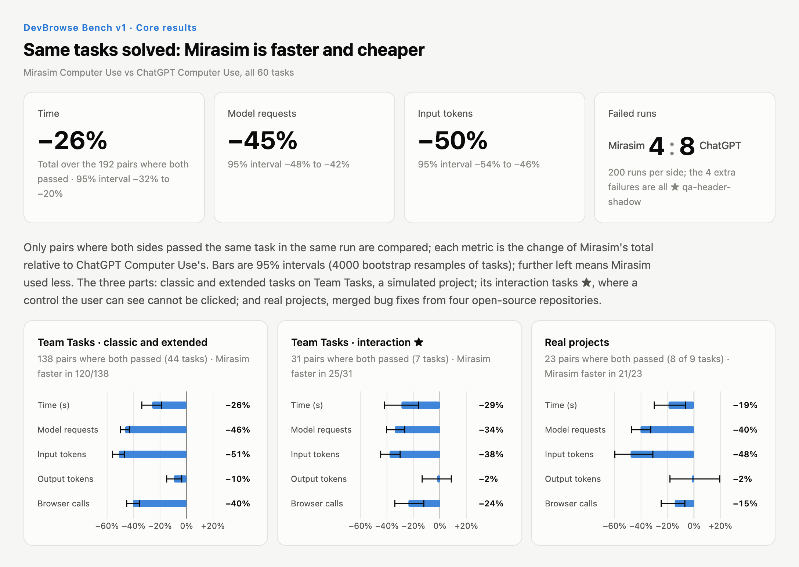

# Mirasim Computer Use

[](https://www.npmjs.com/package/@mirasim/computer-use)
[](LICENSE)
[](https://huggingface.co/datasets/mirasim-ai/devbrowse-bench)

Computer use for Claude Code, Codex and any MCP agent: an open-source MCP server that drives
browsers, macOS apps and Electron apps through their accessibility trees. It runs no model of its
own and needs no API key. The [Mirasim](https://mirasim.ai) desktop app ships the same tools
built in (Settings → Computer Use).



<sub>A real run, 24 s with the model's wait trimmed to 15 s: Claude Code checks its change in the
browser, finds a control covered by a new header layer, fixes the CSS and checks again in one
call. The red and green marks are added for the video. [MP4](docs/media/demo.mp4)</sub>

- **One call runs a whole chain of steps, and every step reports back.** The agent writes a
  short script (open, type, pick, click, wait, read), and the result says what each step did
  and ends with one observation, so the model does not look at the screen after every click.
  The screen reads back as text, a numbered list of elements from the accessibility tree;
  pixels only when text is not enough.
- **A click lands where a user's mouse would.** A click on a control under another layer fails
  and names the layer in the way («fixed bar at the top of the viewport»), instead of reaching
  the control a user could not click.
- **Your own browser and your desktop.** It drives the Chrome you are signed into through the
  Mirasim extension, native macOS apps in the background without taking your mouse and
  keyboard, and Electron apps over their debugging port.

On [DevBrowse Bench v1](#benchmark) it took 26% less time and 45% fewer model requests than
ChatGPT Computer Use, with half the input tokens.

## Install

Needs Node.js 22.19 or later.

```sh
claude mcp add mirasim-cu -- npx -y @mirasim/computer-use mcp   # Claude Code
codex mcp add mirasim-cu -- npx -y @mirasim/computer-use mcp    # Codex
```

Then ask your agent to check something in the mirasim-cu browser. Codex asks before every MCP
call until you approve the two tools in `~/.codex/config.toml`; that, your signed-in Chrome,
macOS and Electron apps, the agent skill and the command line are in
[docs/setup.md](docs/setup.md).

## How it compares

What each project documents, read on 2026-11-18 (sources below the table).

| | Mirasim Computer Use | [Playwright MCP](https://github.com/microsoft/playwright-mcp) | [browser-use](https://github.com/browser-use/browser-use) | [Anthropic computer use](https://platform.claude.com/docs/en/agents-and-tools/tool-use/computer-use-tool) | [ChatGPT Computer Use](https://learn.chatgpt.com/docs/computer-use) |
|---|---|---|---|---|---|
| Open source | Apache-2.0 | Apache-2.0 | MIT; Browser Use Cloud is a paid service | No: an API tool (MIT reference demo) | No: part of the ChatGPT desktop app |
| MCP server for Claude Code and Codex | Yes | Yes | Yes (`browser-use --cli-mcp`) | No: an API tool; built into Claude Code | No: inside the ChatGPT desktop app |
| Model of its own | None; your agent drives it | None | Its agent has one; the MCP mode does not | Claude | OpenAI's models |
| What the model reads | Accessibility tree as text; screenshots on request | Accessibility snapshot as text; vision opt-in | What its Python prints, plus screenshots | Screenshots and pixel coordinates | Screenshots; more is not documented |
| Many steps in one call | Yes: a script, each step reported | One tool per action; `browser_run_code_unsafe` runs a Playwright script | Yes: `browser_exec` runs Python | Several actions per turn (a batch), one tool call each | Not documented |
| A click on a covered control | Fails and names the covering layer | Waits until the element would receive the click, then times out | Not documented | Not documented | Not documented |
| Your signed-in browser | Mirasim extension | Playwright extension (Chrome, Edge) or a CDP endpoint | Running Chrome through remote debugging | Claude in Chrome extension | ChatGPT extension |
| Native desktop apps | macOS, in the background | No | No (a separate, experimental macOS project) | Any app in your VM or container; macOS in Claude Code (preview) | macOS (in the background) and Windows |
| Electron apps | Yes, over the debugging port | Not in the MCP server | Not documented | Through screen control in Claude Code | Not documented |
| DevBrowse Bench v1 | −26% time, −45% model requests | Not run | Not run | Not run | The baseline |

<details>
<summary>Sources</summary>

- Playwright MCP: [README](https://github.com/microsoft/playwright-mcp) (v0.0.85); covered
  elements: Playwright's [actionability checks](https://playwright.dev/docs/actionability)
  ("Receives Events").
- browser-use: [README](https://github.com/browser-use/browser-use) (v1.0.6),
  [MCP server](https://docs.browser-use.com/open-source/mcp),
  [browsers](https://docs.browser-use.com/open-source/browsers),
  [macos-harness](https://github.com/browser-use/macos-harness).
- Anthropic: [computer use tool](https://platform.claude.com/docs/en/agents-and-tools/tool-use/computer-use-tool),
  [reference demo](https://github.com/anthropics/claude-quickstarts/tree/main/computer-use-demo),
  Claude Code [computer use](https://code.claude.com/docs/en/computer-use) and
  [Chrome](https://code.claude.com/docs/en/chrome).
- OpenAI: ChatGPT [computer use](https://learn.chatgpt.com/docs/computer-use),
  [browser](https://learn.chatgpt.com/docs/browser),
  [Chrome extension](https://learn.chatgpt.com/docs/chrome-extension); the API's
  [computer use tool](https://developers.openai.com/api/docs/guides/tools-computer-use) takes an
  `actions` array per call, which the table does not count as the app's behaviour.
- DevBrowse Bench v1 compared only Mirasim Computer Use and ChatGPT Computer Use; its harness
  drives Codex in the ChatGPT desktop app, so the other tools have no comparable run.

</details>

## Benchmark



[DevBrowse Bench](https://huggingface.co/datasets/mirasim-ai/devbrowse-bench) measures browser use in
development work: a coding agent changes a web app, then checks its own work in a browser. v1 has
60 tasks in three parts, the three panels of the figure. 51 are on Team Tasks, a simulated React +
Vite task manager written for the benchmark: 44 classic and extended tasks (features, bug fixes,
QA passes) and 7 interaction tasks ★, bugs where a control the user can see cannot be clicked. 9
are on real projects: merged bug fixes from the open-source repositories of Excalidraw, Lexical,
tldraw and react-admin.

Each task runs as a pair, both sides at the same time in Codex in the ChatGPT desktop app, with
the same model (`gpt-6.1-sol` at medium reasoning effort), the same prompt and the same starting
code. The only difference is the browser tool the agent is told to use: ChatGPT Computer Use (the
in-app browser of Codex), or Mirasim Computer Use 0.1.0-rc.5 as an MCP server. 200 runs per side,
on 2026-11-06 and 2026-11-07; time, model requests and tokens come from Codex's own session
record, and every run was graded by rule-based judges.

| | ChatGPT Computer Use | Mirasim Computer Use |
|---|---|---|
| Runs passed | 192 / 200 | 196 / 200 |

Over the 192 pairs where both sides passed (change = Mirasim total / ChatGPT total − 1, 95%
interval from resampling tasks):

| Metric | Change | 95% interval |
|---|---|---|
| Time | −26% | −32% to −20% |
| Model requests | −45% | −48% to −42% |
| Input tokens | −50% | −54% to −46% |
| Output tokens | −8% | −13% to −3% |
| Browser calls | −37% | −41% to −32% |

Most of the time was saved in round trips: the agent made 45% fewer model requests, while the
output tokens it wrote fell by only 8%. `observe()` returns elements as data, so the agent puts
its checks in the script and gets back a verdict instead of reading the page after every click.
And a click lands where a user's mouse would: a click on a covered control fails and names the
layer that took it. The four extra failures on the other side are all one interaction task ★, a
QA pass where a transparent layer under a sticky header covers a toolbar for mouse clicks: the
report written with ChatGPT Computer Use missed it in 4 of 5 runs, the one written with Mirasim
Computer Use in none.

These numbers describe the two tools as they were on those two days. Around the end of the runs,
ChatGPT Computer Use changed how it uses the browser and began to need fewer model requests per
run. When 39 of the 60 tasks were run again the same way on 2026-11-10 and 2026-11-11, with a
later release of Mirasim Computer Use, the time saving on them was about −16%, against −25% for
the same tasks here. That rerun is not part of v1.

Tasks, judges, every run and the full report are on Hugging Face, in the
[devbrowse-bench dataset](https://huggingface.co/datasets/mirasim-ai/devbrowse-bench)
([v1 report](https://huggingface.co/datasets/mirasim-ai/devbrowse-bench/blob/main/results/v1/REPORT.md)).

## Tools

Two tools, assembled per driver at session start:

| tool | role |
|---|---|
| `computer_repl` | JavaScript over the GUI in a PERSISTENT session: reads (`observe()`, `find(name)`, `text()`, `page()`, `screenshot()`, `diagnostics()`), actions (`click`, `hover`, `setText`, `keys`, `scroll`, `wait`, `focus` + the driver's verbs — `openUrl`, `newTab`, `selectOption`, `paste`, `launchApp`, `menu`, …), and surface HANDLES (`computer.surfaces()` / `computer.surface(id)`) that bind verbs to one tab / window / app. Top-level declarations persist across calls; the first result carries the API reference; every run ends with one observation and a changed/frozen verdict |
| `computer_repl_reset` | discard the JavaScript bindings — surfaces untouched |

Element observations are incremental by default: when little changed since the previous
one, only the diff is sent (refs are sticky, so unchanged lines drop out), with a full
list re-sent periodically.

## License

[Apache License 2.0](LICENSE) © MIRASIM, INC. Parts of the browser extension bridge are adapted
from [Playwright](https://github.com/microsoft/playwright) (Apache-2.0, © Microsoft Corporation);
see [NOTICE](NOTICE). The Windows helper's statically linked Rust crates and their licenses are
listed in [THIRD_PARTY_NOTICES](THIRD_PARTY_NOTICES).

"Mirasim" and the Mirasim logo are trademarks of MIRASIM, INC. and are not licensed under the
Apache License. Chrome, Claude, Codex, ChatGPT, macOS and Windows are trademarks of their
respective owners; this project is not affiliated with or endorsed by them.
