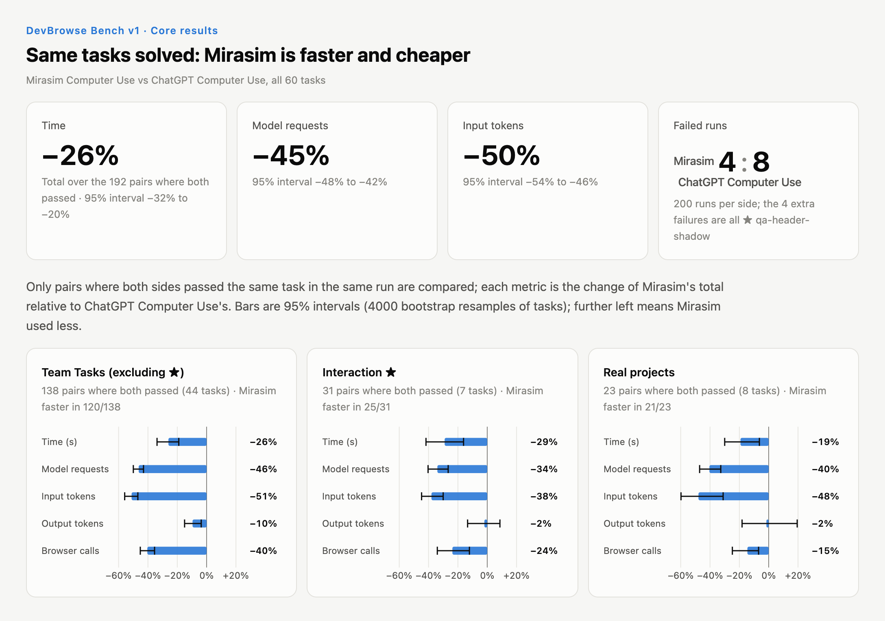

# Mirasim Computer Use

Computer use for any agent: an MCP server that lets the agent you already use (Claude Code,
Codex, or any MCP host) operate browsers, macOS apps, Windows apps and Electron apps.

Think of how a person checks an account balance on a website they use every day. They know the
steps before the page opens, so they just go through them quickly. Someone new to the site has
to take one step, look, and only then work out the next one. Capable models now work like the
experienced person: they plan several GUI steps at once. Mirasim Computer Use is tuned for
exactly that. It runs a multi-step plan reliably and gives the model accurate feedback on every
step, so the model can trust the result instead of checking the screen after each click. With a
strong model, the same task takes fewer model calls and finishes sooner.

The screen reads back as text, a numbered list of elements from the accessibility tree, and
pixels are used only when text is not enough. It runs no model of its own and needs no API key:
the host's agent calls the tools with its own model. The [Mirasim](https://mirasim.ai) desktop
app ships the same tools built in (Settings → Computer Use).

## Benchmark



[DevBrowse Bench](https://github.com/mirasim-ai/devbrowse-bench) measures browser use in
development work: a coding agent changes a web app, then checks its own work in a browser. v1 has
60 tasks: 51 on a simulated React + Vite task manager (features, bug fixes, QA passes) and 9
merged bug fixes from Excalidraw, Lexical, tldraw and react-admin. Each task runs as a pair, both
sides at the same time in Codex in the ChatGPT desktop app, with the same model (`gpt-6.1-sol` at
medium reasoning effort), the same prompt and the same starting code. The only difference is the
browser tool the agent is told to use: ChatGPT Computer Use (the in-app browser of Codex), or
Mirasim Computer Use 0.1.0-rc.5 as an MCP server. 200 runs per side, on 2026-11-06 and
2026-11-07; time, model requests and tokens come from Codex's own session record, and every run
was graded by rule-based judges.

| | ChatGPT Computer Use | Mirasim Computer Use |
|---|---|---|
| Runs passed | 192 / 200 | 196 / 200 |

Over the 192 pairs where both sides passed (change = Mirasim total / ChatGPT total − 1, 95%
interval from resampling tasks):

| Metric | Change | 95% interval |
|---|---|---|
| Time | −26% | −32% to −20% |
| Model requests | −45% | −48% to −42% |
| Input tokens | −50% | −54% to −46% |
| Output tokens | −8% | −13% to −3% |
| Browser calls | −37% | −41% to −32% |

Most of the time was saved in round trips: the agent made 45% fewer model requests, while the
output tokens it wrote fell by only 8%. `observe()` returns elements as data, so the agent puts
its checks in the script and gets back a verdict instead of reading the page after every click.
And a click lands where a user's mouse would: a click on a covered control fails and names the
layer that took it. The four extra failures on the other side are all one QA task, where a
transparent layer under a sticky header covers a toolbar for mouse clicks: the report written with
ChatGPT Computer Use missed it in 4 of 5 runs, the one written with Mirasim Computer Use in none.

These numbers describe the two tools as they were on those two days. Around the end of the runs,
ChatGPT Computer Use changed how it uses the browser and began to need fewer model requests per
run. When 39 of the 60 tasks were run again the same way on 2026-11-10 and 2026-11-11, with a
later release of Mirasim Computer Use, the time saving on them was about −16%, against −25% for
the same tasks here. That rerun is not part of v1.

Tasks, judges, every run and the full report are in the
[DevBrowse Bench repository](https://github.com/mirasim-ai/devbrowse-bench)
([v1 report](https://github.com/mirasim-ai/devbrowse-bench/blob/main/results/v1/REPORT.md)).

## Install

Needs Node.js 22.19 or later. Register the MCP server with your agent:

```sh
claude mcp add mirasim-cu -- npx -y @mirasim/computer-use mcp
```

or install the `mirasim-cu` command once with `npm install -g @mirasim/computer-use`.

In Codex, add it to `~/.codex/config.toml`, and approve both tools: Codex asks before every
MCP call by default, and when it is set never to ask (`approval_policy = "never"`) a tool
without `approval_mode = "approve"` is refused outright — `computer_repl_reset` included,
which is the call a stuck session reaches for:

```toml
[mcp_servers.mirasim-cu]
command = "npx"
args = ["-y", "@mirasim/computer-use", "mcp"]

[mcp_servers.mirasim-cu.tools.computer_repl]
approval_mode = "approve"

[mcp_servers.mirasim-cu.tools.computer_repl_reset]
approval_mode = "approve"
```

**Browser** works out of the box: computer-use drives a Chrome of its own (installed Google
Chrome is required), keeping its profile under `~/.mirasim-computer-use` so logins carry over
between sessions. To drive the browser you are signed into instead, install the
[Mirasim extension](https://chromewebstore.google.com/detail/mirasim/khflooofmndpmafhofjdcpjfgnlpikhg)
and add `-e COMPUTER_USE_BROWSER=extension`. By default the agent sees only the tabs it opens and
the ones you hand it: click the extension's toolbar icon on a tab to hand that tab over, and use
its panel to take tabs back, pause the agent, widen what it may reach or block sites. The icon is
in colour on tabs the agent may use and grey on the rest.

In extension mode the first browser call starts a bridge in the background and registers it as
the extension's native-messaging host: a record under `~/.mirasim-computer-use/native-host/`
and a manifest in each Chromium-family browser's configuration folder. The record names the
program that started it, which under `npx` is a path in npx's cache; a record whose program is
gone is skipped, and every bridge start writes it again.
`npx -y @mirasim/computer-use setup extension --remove` takes it back. The extension serves one
bridge at a time, and the Mirasim desktop app's comes first: while browser control is on there,
extension mode says so at once and does not connect.
Details in [docs/embedding.md](docs/embedding.md#your-own-browser-extension).

**Agent skill.** The package ships a skill for the agent, `mirasim-computer-use`: the mistakes
agents make most with these tools (which browser, a tab it cannot see, the arguments of the tab
verbs, what to do with tabs afterwards, recovering a stuck session). Copy it into Claude Code's
(`~/.claude/skills`) and Codex's (`~/.agents/skills`) skill folders with

```sh
npx -y @mirasim/computer-use setup skill
```

and run it again after an upgrade; `--remove` takes it back. The Mirasim desktop app installs its
own copy.

**Native apps** are opt-in with `COMPUTER_USE_PLATFORMS` (comma-separated, default `browser`):

```sh
claude mcp add mirasim-cu -e COMPUTER_USE_PLATFORMS=browser,macos -- npx -y @mirasim/computer-use mcp
```

- `macos` and `windows` drive native apps through their accessibility tree in the background.
  On macOS, grant Accessibility (and Screen Recording, for screenshots) to the app that runs
  your agent; `mirasim-cu setup macos` checks both.
- `electron` drives any app started with `--remote-debugging-port=<port>`
  (`COMPUTER_USE_ELECTRON_CDP_URL`, default `http://127.0.0.1:9333`).

**Which apps the agent may drive.** Before the agent first touches a native app, the server asks
you through your agent's MCP client (MCP elicitation): allow it once, for the session, or always.
What that looks like depends on the client:

- A client that shows the question (Claude Code in a terminal, for one): you answer it there.
- A non-interactive run (`claude -p`, CI) declines every question unseen, so an app nobody
  allowed is refused. Allow it ahead of time with
  `npx -y @mirasim/computer-use approvals add com.apple.TextEdit` (a macOS bundle id; on Windows
  the executable's name, e.g. `WINWORD`). `approvals` lists them; `approvals remove` revokes one.
- A client without elicitation support cannot ask, so the server drives **every** app the agent
  names. On macOS, `-e COMPUTER_USE_MACOS_FALLBACK_APPS=com.apple.TextEdit,…` narrows that to
  the listed apps.

The macOS and Windows drivers use a small native helper that npm installs prebuilt for macOS
arm64/x64 and Windows x64/arm64. Every setting, the state directory and the host protocol are
documented in [docs/embedding.md](docs/embedding.md).

## Use

```sh
mirasim-cu mcp                   # MCP stdio server — the runtime
mirasim-cu browser open          # summon the managed browser for the user
mirasim-cu setup browser         # dependency bootstrap: verify a driveable Chrome exists
mirasim-cu setup macos           # check Accessibility + Screen Recording; open a missing pane
mirasim-cu approvals             # apps answered "always allow"; add / remove <app>
mirasim-cu setup skill           # copy the agent skill into Claude Code's and Codex's skill folders
```

To drive computer-use from another program — the spawn environment, the host protocol, the
opt-in live preview, the action journal, shared native capture — see
[docs/embedding.md](docs/embedding.md).

The host's agent calls `computer_repl` directly and reads the resulting observation in the current
session. The tool server runs no model of its own.

- **`mcp`** serves the tools to a host that brings its own agent loop:
  ```sh
  claude mcp add mirasim-cu -- mirasim-cu mcp
  ```
  stdout is protocol-only, so the server records nothing by default — and the structured
  `details` of each result (url / verdict / elementCount) never reaches the host at all.
  `COMPUTER_USE_MCP_LOG` is the way to see it: one JSON line per call, plus a `server_start` line
  naming the configuration.
  ```sh
  COMPUTER_USE_MCP_LOG=~/.mirasim-computer-use/mcp.jsonl mirasim-cu mcp
  # {"ts":"…","type":"server_start","version":"0.1.0-rc.1","platforms":"browser","tools":[…]}
  # {"ts":"…","type":"call","tool":"computer_repl","args":{"code":"await w.observe();"},"isError":false,"ms":412,
  #  "details":{"url":"https://example.com","verdict":"changed","elementCount":7,"ledgerLines":2,
  #   "timing":{"runMs":96,"observeMs":310,"steps":[{"kind":"observe","target":"","ok":true,"ms":96,"note":"7 elements"}]}}}
  ```
  `details.timing` says where a `computer_repl` call's time went: each step of the code (reads,
  waits and expects included) with its `ms`, the run in total (`runMs`), and the closing
  observation apart (`observeMs`, the settle re-check included). The model's own journal carries
  none of it. Failures are logged the same way (`isError: true`, with `details.error`), including a tool
  name the host got wrong. Missing parent directories are created; a log that cannot be
  written is dropped rather than failing the call.

## Tools

Two tools, assembled per driver at session start:

| tool | role |
|---|---|
| `computer_repl` | JavaScript over the GUI in a PERSISTENT session: reads (`observe()`, `find(name)`, `text()`, `page()`, `screenshot()`, `diagnostics()`), actions (`click`, `hover`, `setText`, `keys`, `scroll`, `wait`, `focus` + the driver's verbs — `openUrl`, `newTab`, `selectOption`, `paste`, `launchApp`, `menu`, …), and surface HANDLES (`computer.surfaces()` / `computer.surface(id)`) that bind verbs to one tab / window / app. Top-level declarations persist across calls; the first result carries the API reference; every run ends with one observation and a changed/frozen verdict |
| `computer_repl_reset` | discard the JavaScript bindings — surfaces untouched |

Element observations are incremental by default: when little changed since the previous
one, only the diff is sent (refs are sticky, so unchanged lines drop out), with a full
list re-sent periodically.

## License

[Apache License 2.0](LICENSE) © MIRASIM, INC. Parts of the browser extension bridge are adapted
from [Playwright](https://github.com/microsoft/playwright) (Apache-2.0, © Microsoft Corporation);
see [NOTICE](NOTICE). The Windows helper's statically linked Rust crates and their licenses are
listed in [THIRD_PARTY_NOTICES](THIRD_PARTY_NOTICES).

"Mirasim" and the Mirasim logo are trademarks of MIRASIM, INC. and are not licensed under the
Apache License. Chrome, Claude, Codex, ChatGPT, macOS and Windows are trademarks of their
respective owners; this project is not affiliated with or endorsed by them.
