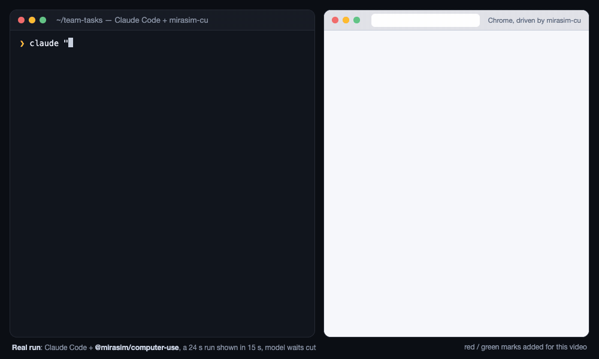
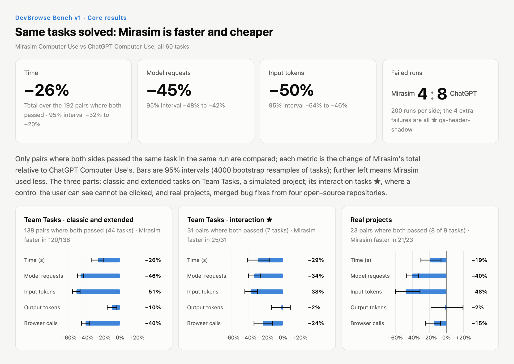

# Mirasim Computer Use

[English](README.md) | 简体中文 | [日本語](README.ja.md) | [한국어](README.ko.md)

[](https://www.npmjs.com/package/@mirasim/computer-use)
[](LICENSE)
[](https://huggingface.co/datasets/mirasim-ai/devbrowse-bench)

给 Claude Code、Codex 以及任何 MCP 智能体用的 computer use：一个开源的 MCP 服务器，通过无障碍树操作浏览器、macOS
应用和 Electron 应用。它不自带模型，也不需要 API key。[Mirasim](https://mirasim.ai) 桌面应用内置了同一套工具（设置 →
Computer Use）。



<sub>一次真实运行，实际 24 秒，剪掉模型的等待后为 15 秒：Claude Code 在浏览器里验收自己的改动，发现一个控件被新加的页头层挡住，改好
CSS 后用一次调用重新验完。红框和绿框是为视频加的标注。[MP4](docs/media/demo.mp4)</sub>

- **一次调用跑完一串步骤，每一步都有回报。** 智能体写一段简短的脚本（打开、输入、选择、点击、等待、读取），返回结果会说明每一步做了什么，最后附上一次观察，所以模型不必每点一下就看一次屏幕。屏幕读回来是文本，即无障碍树里带编号的元素列表；只有文本不够用时才用截图。
- **点击落在用户鼠标会落的地方。** 点到被其他图层挡住的控件时，调用会失败，并指出挡住它的是哪一层（«fixed bar at the top of the viewport»），而不会去点一个用户实际点不到的控件。
- **你自己的浏览器和桌面。** 通过 Mirasim 扩展操作你已登录的 Chrome；在后台操作原生 macOS 应用，不占用你的鼠标和键盘；通过调试端口操作 Electron 应用。

在 [DevBrowse Bench v1](#评测) 上，它比 ChatGPT Computer Use 少用 26% 的时间、少发 45% 的模型请求，输入 token 只用了一半。

## 安装

需要 Node.js 22.19 或更高版本。

```sh
claude mcp add mirasim-cu -- npx -y @mirasim/computer-use mcp   # Claude Code
codex mcp add mirasim-cu -- npx -y @mirasim/computer-use mcp    # Codex
```

也可以作为插件安装，智能体技能会一起装好（[说明](docs/setup.md#plugin)，英文）：

```sh
claude plugin install mirasim-computer-use --marketplace mirasim-ai/computer-use
codex plugin marketplace add mirasim-ai/computer-use && codex plugin add mirasim-computer-use@mirasim
```

装好后，让你的智能体在 mirasim-cu 浏览器里检查点什么就行。在 `~/.codex/config.toml` 里批准这两个工具之前，Codex 每次调用
MCP 前都会先问你；这个配置，以及操作你已登录的 Chrome、macOS 和 Electron 应用、智能体技能和命令行的说明，都在
[docs/setup.md](docs/setup.md)（英文）里。

## 对比

以下是各项目文档里写明的内容，查阅于 2026-11-18（出处在表格下方）。

| | Mirasim Computer Use | [Playwright MCP](https://github.com/microsoft/playwright-mcp) | [browser-use](https://github.com/browser-use/browser-use) | [Anthropic computer use](https://platform.claude.com/docs/en/agents-and-tools/tool-use/computer-use-tool) | [ChatGPT Computer Use](https://learn.chatgpt.com/docs/computer-use) |
|---|---|---|---|---|---|
| 开源 | Apache-2.0 | Apache-2.0 | MIT；Browser Use Cloud 是付费服务 | 否：是一个 API 工具（参考演示为 MIT） | 否：属于 ChatGPT 桌面应用 |
| 可作为 Claude Code 和 Codex 的 MCP 服务器 | 是 | 是 | 是（`browser-use --cli-mcp`） | 否：是 API 工具；Claude Code 内置 | 否：在 ChatGPT 桌面应用内 |
| 自带模型 | 无，由你的智能体驱动 | 无 | 它的智能体自带；MCP 模式不带 | Claude | OpenAI 的模型 |
| 模型读到的内容 | 文本形式的无障碍树；按需截图 | 文本形式的无障碍快照；视觉能力需开启 | 其 Python 代码打印的内容，加截图 | 截图和像素坐标 | 截图；其余未见文档 |
| 一次调用跑多步 | 是：一段脚本，每步都有回报 | 每个动作一个工具；`browser_run_code_unsafe` 可运行 Playwright 脚本 | 是：`browser_exec` 运行 Python | 每轮可有多个动作（批量），每个动作一次工具调用 | 未见文档 |
| 点到被挡住的控件 | 失败，并指出挡住它的图层 | 等待元素能接收点击，一直不能就超时 | 未见文档 | 未见文档 | 未见文档 |
| 你已登录的浏览器 | Mirasim 扩展 | Playwright 扩展（Chrome、Edge）或 CDP 端点 | 通过远程调试连接正在运行的 Chrome | Claude in Chrome 扩展 | ChatGPT 扩展 |
| 原生桌面应用 | macOS，在后台 | 否 | 否（另有一个实验性的 macOS 项目） | 你的虚拟机或容器里的任意应用；Claude Code 里支持 macOS（预览） | macOS（在后台）和 Windows |
| Electron 应用 | 是，通过调试端口 | MCP 服务器不支持 | 未见文档 | Claude Code 里通过屏幕控制 | 未见文档 |
| DevBrowse Bench v1 | 时间 −26%，模型请求 −45% | 未测 | 未测 | 未测 | 对照基线 |

<details>
<summary>出处</summary>

- Playwright MCP：[README](https://github.com/microsoft/playwright-mcp)（v0.0.85）；被挡住的元素：Playwright 的
  [可操作性检查](https://playwright.dev/docs/actionability)（"Receives Events"）。
- browser-use：[README](https://github.com/browser-use/browser-use)（v1.0.6）、
  [MCP 服务器](https://docs.browser-use.com/open-source/mcp)、
  [浏览器](https://docs.browser-use.com/open-source/browsers)、
  [macos-harness](https://github.com/browser-use/macos-harness)。
- Anthropic：[computer use 工具](https://platform.claude.com/docs/en/agents-and-tools/tool-use/computer-use-tool)、
  [参考演示](https://github.com/anthropics/claude-quickstarts/tree/main/computer-use-demo)、
  Claude Code 的 [computer use](https://code.claude.com/docs/en/computer-use) 和
  [Chrome](https://code.claude.com/docs/en/chrome)。
- OpenAI：ChatGPT 的 [computer use](https://learn.chatgpt.com/docs/computer-use)、
  [浏览器](https://learn.chatgpt.com/docs/browser)、
  [Chrome 扩展](https://learn.chatgpt.com/docs/chrome-extension)；API 的
  [computer use 工具](https://developers.openai.com/api/docs/guides/tools-computer-use)每次调用接收一个
  `actions` 数组，表中不把它算作桌面应用的行为。
- DevBrowse Bench v1 只比较了 Mirasim Computer Use 和 ChatGPT Computer Use；它的测试框架驱动的是 ChatGPT
  桌面应用里的 Codex，所以其他工具没有可比的结果。

</details>

## 评测



[DevBrowse Bench](https://huggingface.co/datasets/mirasim-ai/devbrowse-bench) 衡量开发工作中的浏览器使用：编程智能体修改一个
Web 应用，然后自己在浏览器里检查结果。v1 有 60 个任务，分三部分，对应图中三个面板。其中 51 个在 Team Tasks 上，这是为评测专门写的
React + Vite 模拟任务管理应用：44 个经典和扩展任务（新功能、修 bug、QA 走查），以及 7 个交互任务 ★，即用户看得见却点不了某个控件的
bug。另外 9 个来自真实项目：Excalidraw、Lexical、tldraw 和 react-admin 开源仓库里已合并的 bug 修复。

每个任务成对运行，两边同时在 ChatGPT 桌面应用的 Codex 里跑，用同一个模型（`gpt-6.1-sol`，中等推理强度）、同一段提示词、同一份初始代码。唯一的区别是告诉智能体用哪个浏览器工具：ChatGPT Computer Use（Codex 的内置浏览器），或者作为 MCP 服务器的 Mirasim Computer Use
0.1.0-rc.5。每边 200 次运行，时间是 2026-11-06 和 2026-11-07；时间、模型请求和 token 数取自 Codex 自己的会话记录，每次运行都由基于规则的评判器打分。

| | ChatGPT Computer Use | Mirasim Computer Use |
|---|---|---|
| 通过次数 | 192 / 200 | 196 / 200 |

在两边都通过的 192 对中（变化 = Mirasim 总量 / ChatGPT 总量 − 1，95% 区间由对任务重采样得出）：

| 指标 | 变化 | 95% 区间 |
|---|---|---|
| 时间 | −26% | −32% 至 −20% |
| 模型请求 | −45% | −48% 至 −42% |
| 输入 token | −50% | −54% 至 −46% |
| 输出 token | −8% | −13% 至 −3% |
| 浏览器调用 | −37% | −41% 至 −32% |

省下的时间大多来自往返次数：智能体发出的模型请求少了 45%，而它写出的输出 token 只少了 8%。`observe()` 把元素作为数据返回，所以智能体把检查写进脚本，拿回一个结论，不用每点一下就读一遍页面。而且点击落在用户鼠标会落的地方：点到被挡住的控件会失败，并指出接住这次点击的图层。对方多出的四次失败都出在同一个交互任务 ★ 上：这是一次 QA 走查，粘性页头下面有一层透明图层挡住了工具栏，鼠标点不到。用 ChatGPT Computer Use 写出的报告在 5 次里有 4 次漏掉了这个问题，用 Mirasim Computer Use 写出的报告一次都没漏。

这些数字反映的是两个工具在那两天的状态。在这批运行快结束时，ChatGPT Computer Use 改变了使用浏览器的方式，每次运行需要的模型请求开始减少。2026-11-10 和 2026-11-11 用同样的方法、配合更新版本的 Mirasim Computer Use 重跑了 60 个任务中的 39 个，这些任务上节省的时间约为 −16%，而在本次评测中同样这些任务是 −25%。那次重跑不属于 v1。

任务、评判器、每次运行的记录和完整报告都在 Hugging Face 的
[devbrowse-bench 数据集](https://huggingface.co/datasets/mirasim-ai/devbrowse-bench)里（[v1 报告](https://huggingface.co/datasets/mirasim-ai/devbrowse-bench/blob/main/results/v1/REPORT.md)）。

## 工具

两个工具，在会话开始时按驱动组装：

| 工具 | 作用 |
|---|---|
| `computer_repl` | 在一个持久会话里用 JavaScript 操作 GUI：读取（`observe()`、`find(name)`、`text()`、`page()`、`screenshot()`、`diagnostics()`）、动作（`click`、`hover`、`setText`、`keys`、`scroll`、`wait`、`focus`，以及驱动自己的动词：`openUrl`、`newTab`、`selectOption`、`paste`、`launchApp`、`menu` 等），还有把动词绑定到某个标签页、窗口或应用的 surface 句柄（`computer.surfaces()` / `computer.surface(id)`）。顶层声明在多次调用间保留；第一次的结果附带 API 参考；每次运行都以一次观察和 changed/frozen 判定结束 |
| `computer_repl_reset` | 丢弃 JavaScript 绑定，不动任何 surface |

元素观察默认是增量的：和上一次相比变化不大时只发送差异（ref 保持不变，所以没变的行不再重复），并定期重新发送完整列表。

## 许可证

[Apache License 2.0](LICENSE) © MIRASIM, INC. 浏览器扩展桥接的部分代码改编自
[Playwright](https://github.com/microsoft/playwright)（Apache-2.0，© Microsoft Corporation），见 [NOTICE](NOTICE)。Windows
辅助程序静态链接的 Rust crate 及其许可证列在 [THIRD_PARTY_NOTICES](THIRD_PARTY_NOTICES) 里。

"Mirasim" 及 Mirasim 标志是 MIRASIM, INC. 的商标，不在 Apache License 的授权范围内。Chrome、Claude、Codex、ChatGPT、macOS 和
Windows 是其各自所有者的商标；本项目与它们没有关联，也未获其认可。
